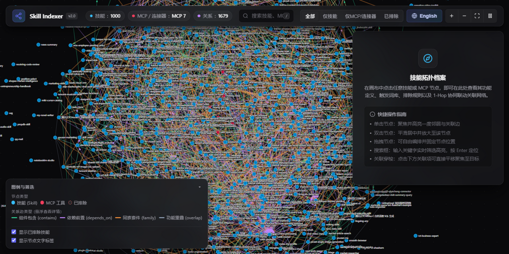

<div align="center">

# ⚡ 点将台 · Skill Gateway

**面向 AI Coding Agent 的本地技能拓扑编排、毫秒级直达与知识图谱治理中枢**  
*The Local Skill Intelligence & DAG Orchestration Engine for AI Coding Agents*

<p align="center">
  <a href="https://github.com/qi-xiao-bai/skill-gateway/actions/workflows/ci.yml">
    
  </a>
  <a href="https://www.python.org/">
    
  </a>
  <a href="LICENSE">
    
  </a>
  <a href="#">
    
  </a>
  <a href="#">
    
  </a>
  <a href="#">
    
  </a>
</p>

<p align="center">
  <a href="#-为什么需要点将台">为什么需要</a> •
  <a href="#-核心能力">核心能力</a> •
  <a href="#-5-分钟极速上手">快速开始</a> •
  <a href="#-可视化拓扑看板">图谱看板</a> •
  <a href="#-架构设计与分层加载">架构设计</a> •
  <a href="#-命令速查手册">命令手册</a> •
  <a href="README_EN.md">English</a>
</p>

</div>

---

<div align="center">
  
  <p><sub>图：纯本地单文件 D3.js 力导向图谱 —— 实时穿透“全部 / 技能 / MCP / 连接器”与平台绑定下钻</sub></p>
</div>

---

## 💡 为什么需要点将台？

在当前以 **Claude Code、Antigravity、Cursor、WorkBuddy、Dify** 为代表的 AI 编程智能体时代，随着开发者安装的本地技能与 MCP 工具达到几十甚至上百个，传统模式会迅速撞上三大工程瓶颈：

| 传统痛点 | 瓶颈表现 | 点将台 (Skill Gateway) 的解法 |
| :--- | :--- | :--- |
| **💥 上下文严重爆炸** | 几十个 `SKILL.md` 全文常驻 System Prompt，消耗数十万 Token，首字时延（TTFT）与推理费用激增 | **L0/L1/L2 按需分层与硬配额**：高密度 dense 索引仅占极少字符，上下文占用减少 **97.7%（44× 压缩）** |
| **🧩 孤立协同难串联** | 复杂工程需求（如“重构治理 + 单元测试 + 安全卡点 + 交付”）各个技能各干各的，缺乏依赖拓扑与接力 | **Kahn 依赖拓扑动态分层**：基于 `depends_on` 边动态生成 DAG 流水线与 Context Handoff，拒绝硬编码模板 |
| **🔍 资产黑盒不可视** | 本地装了哪些技能、哪些 MCP 工具、有没有坏描述/重名冲突/断链，完全无法宏观掌控 | **单文件离线 D3.js 图谱与命中账本**：零外部网络依赖，节点/关系边/健康体检/Token 审计一图看全 |

---

## ✨ 核心能力

### 1. 🕸️ 多技能智能 DAG 串联编排 (Pipeline Chaining)
- **动态图谱拓扑分层**：基于技能元数据的依赖关系边（`depends_on`、`contains`、`similar`）做拓扑排序，把复合任务拆解为阶段清晰的端到端 DAG 流水线；
- **全生命周期开发规范**：无缝覆盖“拆解规划 → 资料核查 → 编码实现 → 测试验证 → 修错排查 → 重构治理 → 审查把关 → 归档交付”标准工程阶段；
- **上下文接力 (Context Handoff)**：上游技能的输出自动传递至下游，查无依赖时诚实推选并行候选，严禁伪造时序。

### 2. ⚡ 毫秒级语义检索与代理直达 (Scoring & Direct Proxy)
- **双语 CJK 优先检索**：内置 CJK 2/3-gram 分词与动态 IDF 加权算法，精准匹配中英文技术专名与触发短语；
- **动态长尾剪枝与配额硬顶**：`MAX_RETRIEVAL_TOP = 20` 配额控制，自动截断低于最大证据 25% 的无关低质技能；
- **透明代理直达**：单点需求自动命中最佳候选并代理执行，打分并列时输出证据供裁决，零命中自动生成能力缺口工单。

### 3. 📊 交互式可视化拓扑看板 (100% Offline D3 Dashboard)
- **纯本地单文件交付**：内嵌完整 D3.js 力导向引擎，完全脱离外部网络与 CDN，内网/离线沙箱 100% 可用；
- **多维度即时切片**：支持在 `全部`、`技能`、`MCP`、`连接器` 视图间平滑过渡，支持平台/Agent 归属下钻；
- **节点拓扑档案**：单击高亮 1-Hop 关联网络，查看技能提取能力、触发词、前置依赖及调用频次。

### 4. 💰 Token 经济学审计与实测台账 (Token Ledger & A/B Bench)
- **真实 A/B 会话实测 (`bench`)**：对比“全量常驻”与“网关按需注入”的真实 Token 消耗差值；
- **命中率与缺口账本 (`ledger`)**：记录技能命中榜单与零命中 Query，自动定位团队 Agent 技能库短板。

### 5. 🛡️ 主动自省自愈与工业级健壮性 (Self-Healing & Cross-Platform)
- **毫秒级目录感知**：利用物理变动指纹自动进行增量更新，新技能落盘秒级同步；
- **零外部依赖 (Pure Stdlib)**：全模块由 Python 标准库精心打造，开箱即用，无 `pip install` 负担；
- **跨平台严苛 CI 验证**：在 Ubuntu 与 Windows 双系统、Python 3.10 与 3.13 环境下保持 100% 测试通过。

---

## ⚡ 5 分钟极速上手

### 方式一：作为 Agent 元技能挂载（推荐）

将本仓库克隆至你的 Agent 宿主技能目录：

```bash
# 挂载到 Claude Code / Antigravity / Cursor 等技能目录
git clone https://github.com/qi-xiao-bai/skill-gateway.git ~/.claude/skills/skill-gateway
```

挂载完成后即刻生效！在对话框中直接对 Agent 下达自然语言指令即可触发：
- *“帮我把这个复杂重构任务编排成一个多阶段流水线”*（自动触发拓扑编排）
- *“现在技能库有哪些工具？上下文开销如何？”*（自动触发 Token 账本与体检）

---

### 方式二：CLI 独立体验与看板启动

```bash
# 1. 克隆代码
git clone https://github.com/qi-xiao-bai/skill-gateway.git
cd skill-gateway

# 2. 一键建立本地技能索引与关系图谱
python scripts/build_index.py index

# 3. 启动本地交互式 D3.js 拓扑看板并在浏览器打开
python scripts/build_index.py dashboard --serve --open
```

控制台将输出本地服务地址（如 `http://127.0.0.1:8123/skill-dashboard.html`），即可直观探索全库拓扑！

---

## 🗺️ 架构设计与分层加载

为彻底解决大模型上下文臃肿问题，点将台借鉴现代化高信息密度设计，对技能资产实行三层分级治理：

```
                    ┌────────────────────────┐
                    │ 本地技能目录 / MCP 配置 │
                    └───────────┬────────────┘
                                │ 毫秒级扫描 + 拓扑提取
                                ▼
                    ┌────────────────────────┐
                    │ 知识图谱 (DAG Edges)   │
                    │ depends_on / contains  │
                    └───────────┬────────────┘
                                │ 分层编译
        ┌───────────────────────┼───────────────────────┐
        ▼                       ▼                       ▼
┌───────────────┐       ┌───────────────┐       ┌───────────────┐
│  L0 极简层    │       │  L1 紧凑摘要  │       │  L2 完整原文  │
│ 仅名称列表    │       │ 单行定长 Dense│       │ 完整 SKILL.md │
│ (问有哪些技能) │       │ (常驻检索路由)│       │ (命中按需加载)│
└───────────────┘       └───────────────┘       └───────────────┘
```

| 档位 | 产物形态 | 内容与用途 | 注入策略 |
| :--- | :--- | :--- | :--- |
| **L0** | `skills.L0.txt` | 纯技能名称与类型列表 | 极低消耗，适合全局探测有哪些工具 |
| **L1** | `skill-index.llms.txt` | 一行一技能、硬配额截断的 dense 紧凑索引 | **常驻系统提示词首选**，兼顾高召回与低 Token |
| **L2** | `skills.L2.map.json` | 技能标识到本地 `SKILL.md` 物理文件映射 | **零常驻**，仅当 L1 命中且确定采纳后精准读取 |
| **图** | `skills.edges.json` | 依赖、包含、相似等关系边集合 | 编排与关系发现时按需计算调用 |

---

## 💻 核心命令速查手册

所有命令均支持在仓库根目录直接运行（由统一调度入口 `scripts/build_index.py` 驱动）：

| 分类 | 命令 | 说明 |
| :--- | :--- | :--- |
| **调度** | `python scripts/build_index.py pipeline "<复合任务>"` | **多技能 DAG 串联编排**：拓扑分层并输出阶段协同矩阵 |
| | `python scripts/build_index.py chat "<单点需求>"` | **智能问答与代理直达**：推荐最优技能并挂载 1-Hop 关联上下文 |
| | `python scripts/build_index.py route "<用户话术>"` | **意图路由**：把用户自然语言映射为最佳 CLI 命令 |
| **检索** | `python scripts/build_index.py search <关键词> [--top N]` | **排序检索**：置顶提权 + 动态剪枝的高精度技能召回 |
| | `python scripts/build_index.py list [--all]` | 浏览本地技能与 MCP 工具清单 |
| | `python scripts/build_index.py detail <技能名>` | 查阅某技能的完整 `SKILL.md` 正文 |
| | `python scripts/build_index.py related <技能名>` | 查阅某技能与其他技能的拓扑关系边 |
| **可视化**| `python scripts/build_index.py dashboard --serve --open` | **启动交互图谱**：本地起服并在浏览器打开 D3 力导向看板 |
| **审计** | `python scripts/build_index.py audit` | **Token 经济审计**：单次选型对比与容量明细 |
| | `python scripts/build_index.py bench [<基线> <网关>]` | **注入台账实测**：查看累计注入或计算 A/B 会话节省比 |
| | `python scripts/build_index.py doctor` | **技能体检**：检测坏描述、跨类型重名、孤岛与断链 |
| **维护** | `python scripts/build_index.py update` | **增量同步**：毫秒级扫描并增量对齐变动 |
| | `python scripts/build_index.py clean` | **纯净复原**：清空所有运行时中间产物与缓存 |

---

## 🧪 工程质量与跨平台测试

点将台坚持严苛的软件工程自洽标准：
- **测试覆盖**：包含 130+ 项覆盖索引编译、IDF 打分、Kahn 拓扑排序、A/B 台账与自愈逻辑的完整单元测试；
- **全矩阵 CI 守护**：每次代码提交自动在 **Ubuntu** 与 **Windows**、**Python 3.10** 与 **Python 3.13** 上执行自动化流水线；
- **零依赖承诺**：不引入任何不可控的三方外部包，确保在任意安全隔离区与内网容器环境皆可开箱即跑。

---

## 📄 开源许可证

本项目基于 [MIT License](LICENSE) 开源，欢迎自由商用、集成与定制开发。
